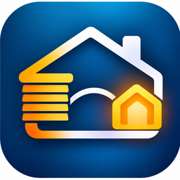

<p align="center">
  
</p>

# Homebridge Somfy TaHoma (tplnet)

[](https://www.npmjs.com/package/@tplnet/homebridge-tahoma)
[](https://github.com/tplnet/homebridge-tahoma/actions/workflows/ci.yml)
[](https://github.com/tplnet/homebridge-tahoma/actions/workflows/compat.yml)
[](https://github.com/tplnet/homebridge-tahoma/actions/workflows/malware.yml)
[](https://www.npmjs.com/package/@tplnet/homebridge-tahoma?activeTab=versions)
[](LICENSE)

Package: [`@tplnet/homebridge-tahoma`](https://www.npmjs.com/package/@tplnet/homebridge-tahoma)

Control your **Somfy TaHoma** devices – roller shutters, blinds, awnings, gates, garage doors, lights, heating, alarms, sensors – with **Apple Home** and Siri, through [Homebridge](https://homebridge.io).

*What is Homebridge?* A free, open-source program that runs at home (e.g. on a Raspberry Pi or a NAS) and brings devices without built-in Apple Home support into the Home app. This plugin connects it to your Somfy TaHoma gateway.

For **Somfy TaHoma** / TaHoma Switch / Connexoon – via the **local API** of your TaHoma gateway or via the Somfy cloud. Other Overkiz based services (Cozytouch, Hi Kumo, Flexom, Energeasy): see [Somfy TaHoma only](#somfy-tahoma-only-version-3).

> Based on [dubocr/homebridge-tahoma](https://github.com/dubocr/homebridge-tahoma) by Romain Duboc, maintained independently. Since version 3 the API client is built in (derived from [dubocr/overkiz-client](https://github.com/dubocr/overkiz-client)); it uses only Node.js built-ins and one small package for the gateway search.
> It is a **drop-in replacement**: the platform name stays `Tahoma`, so your configuration and your accessories in Apple Home are kept – see [Migrating](#migrating-from-homebridge-tahoma).
> Changes compared to the original: [CHANGELOG.md](CHANGELOG.md).

> **Note:** Private hobby project, developed in spare time with the help of AI tools. Use at your own risk; support is best effort. See the [disclaimer](#disclaimer).

## Contents

- [Requirements](#requirements)
- [Installation](#installation)
- [Migrating from homebridge-tahoma](#migrating-from-homebridge-tahoma)
- [Configuration](#configuration)
- [Local API (recommended)](#local-api-recommended)
- [Supported devices](#supported-devices)
- [Troubleshooting](#troubleshooting)
- [Compatibility and security](#compatibility-and-security)
- [Privacy](#privacy)
- [Documentation](#documentation)
- [Contributing](#contributing)
- [Releasing (maintainers)](#releasing-maintainers)
- [Disclaimer](#disclaimer)
- [License and credits](#license-and-credits)

## Requirements

- Homebridge 1.8 or 2.x (tested with Homebridge 2.5)
- Node.js 22, 24 or 26
- One of the supported services:

| `service` | Vendor | Products |
|---|---|---|
| `local` | Somfy local API | TaHoma, TaHoma Switch – [set up the local API](#local-api-recommended) |
| `somfy_europe` | Somfy Europe | TaHoma, TaHoma Switch, Connexoon IO, Orange connectivity kit |
| `somfy_australia` | Somfy Australia | Connexoon RTS and other products in Australia |
| `somfy_north_america` | Somfy North America | TaHoma and other products in North America |

### Somfy TaHoma only (version 3)

> [!IMPORTANT]
> Version 3 supports **Somfy TaHoma only** – local API and Somfy cloud. Devices of other brands connected to a TaHoma gateway stay supported.
>
> Atlantic / Thermor / Sauter **Cozytouch**, Hitachi **Hi Kumo**, **Flexom** and Rexel **Energeasy** are no longer supported: they could not be tested by the maintainer. If you use one of them, stay on **version 2.x** (Homebridge UI → plugin → *Manage Version*) or use the original [homebridge-tahoma](https://github.com/dubocr/homebridge-tahoma). Version 3 logs an error and does nothing with these services – your accessories are kept for the downgrade.

## Installation

**Homebridge UI (recommended):** open *Plugins*, search for `@tplnet/homebridge-tahoma`, install it and fill in the settings form.

**Command line:**

```sh
npm install -g @tplnet/homebridge-tahoma
```

Then add the platform to your `config.json` (see [Configuration](#configuration)) and restart Homebridge.

## Migrating from homebridge-tahoma

> **Important:** never have both plugins installed at the same time. Homebridge only hands the cached accessories over to the new plugin if exactly one plugin provides the `Tahoma` platform. With both installed it removes them as orphaned – and Apple Home loses the rooms, scenes and automations of these accessories.

1. Back up Homebridge (Homebridge UI → *Settings* → *Backup*).
2. **First** uninstall `homebridge-tahoma`, **then** install `@tplnet/homebridge-tahoma`.
3. Keep your existing `Tahoma` platform block in `config.json` unchanged (same `service`, same credentials – switching between cloud and local API changes the device identifiers).
4. Restart Homebridge. For each accessory the log shows *"it seems like the plugin name changed from 'homebridge-tahoma' to '@tplnet/homebridge-tahoma'"* – the accessories have been taken over.

## Configuration

### Local API (recommended)

```json
{
    "platforms": [
        {
            "platform": "Tahoma",
            "name": "TaHoma",
            "service": "local",
            "user": "2001-1234-5678",
            "password": "YOUR-LOCAL-API-TOKEN"
        }
    ]
}
```

`user` is the gateway PIN (or its IPv4 address), `password` the token from the TaHoma app – see [Local API](#local-api-recommended).

### Cloud

```json
{
    "platforms": [
        {
            "platform": "Tahoma",
            "name": "TaHoma",
            "service": "somfy_europe",
            "user": "user@example.com",
            "password": "MyPassw0rd"
        }
    ]
}
```

### More options

The most important options are `service`, `user` and `password`. All other options – update intervals, hidden devices, scenarios, settings for single devices, several gateways of one installation (TaHoma 2.8) – are described in **[docs/configuration.md](https://github.com/tplnet/homebridge-tahoma/blob/master/docs/configuration.md)**. The settings form of the Homebridge UI explains them as well.

- **Beta versions:** bigger changes (such as version 3.0.0) are published as a beta first – how to try one: [Beta versions](https://github.com/tplnet/homebridge-tahoma/blob/master/docs/configuration.md#beta-versions).

## Local API (recommended)

The local API talks directly to your gateway in your home network: no cloud account in Homebridge, no internet dependency, no rate limits and state changes within seconds.

**Supported:** TaHoma and TaHoma Switch. **Not supported:** the 1st generation square TaHoma box and the Connectivity Kit.

1. Open the **TaHoma by Somfy** app.
2. Go to *Configure the installation* → *Access the parameters* of your gateway.
3. Tap the gateway PIN (e.g. `2001-1234-5678`) **7 times** quickly to enable *Developer Mode*.
4. Accept the terms and **generate a token**. Copy it right away – it is only shown once.
5. Configure the plugin with `"service": "local"`, the PIN as `user` and the token as `password`.

In the Homebridge UI, the tab **Connection** of the plugin settings finds the gateways in your network and tests the connection with your token before you save.

The gateway is found in your network by its PIN (mDNS). If Homebridge runs in another network or VLAN, use the gateway's IP address as `user` (preferably with a fixed DHCP lease).

> **Note:** cloud and local API use different device identifiers. Switching an existing setup from cloud to local makes Apple Home see all accessories as new ones – rooms and automations have to be set up again.

More information: [Somfy TaHoma Developer Mode](https://github.com/Somfy-Developer/Somfy-TaHoma-Developer-Mode).

## Supported devices

Roller shutters, exterior and interior venetian blinds, adjustable slats, awnings, pergolas, screens, curtains, swinging shutters, windows and window handles, garage doors and gates, door locks, lights and on/off switches, sirens and alarms, heating (Somfy thermostats and valves, Atlantic io heaters and towel dryers), water heaters, ventilation, and sensors for temperature, humidity, light, air quality, smoke, water, rain, contact, occupancy and electricity consumption.

A device type that is not supported shows up in the log as *"… not supported"*. Please [open an issue](https://github.com/tplnet/homebridge-tahoma/issues) with that log line and the device's widget name.

## Troubleshooting

Common problems and what to do – gateway not found, certificate errors, `429 QUOTA_EXCEEDED`, states not updated – are described in **[docs/troubleshooting.md](https://github.com/tplnet/homebridge-tahoma/blob/master/docs/troubleshooting.md)**. For a detailed log, set `"debug": true` and restart Homebridge.

## Compatibility and security

This plugin is kept compatible with the **newest Homebridge release** and free of **known vulnerabilities (CVEs)** and **malware**:

- **Weekly and on every dependency change** the [Compatibility & CVE check](https://github.com/tplnet/homebridge-tahoma/actions/workflows/compat.yml) workflow
  - runs `npm audit` – any known vulnerability in the runtime dependencies fails the check,
  - builds the plugin and starts it with **homebridge@latest** and **homebridge@beta** on Node.js 22, 24 and 26 (`npm run smoke`): the plugin must load, be accepted as compatible (`engines`) and initialise without errors.
- **Every release** runs the same CVE, malware and Homebridge checks before the version is staged on npm – a release with a known vulnerability, malware or an incompatibility is not published.
- **Malware scan** ([workflow](https://github.com/tplnet/homebridge-tahoma/actions/workflows/malware.yml), weekly, on every dependency change and before every release): [OSV-Scanner](https://google.github.io/osv-scanner/) checks all dependencies against the list of **known malicious npm packages**, and [ClamAV](https://www.clamav.net/) scans the package as it is published plus all installed dependencies for **malware**. Dependencies are installed with `npm ci --ignore-scripts`, so their install scripts never run in the build.
- **Dependabot** opens weekly pull requests for dependency and GitHub Actions updates. Each of them runs CI and the full compatibility & CVE check (Homebridge latest/beta, Node.js 22/24/26) – when all checks are green, the update can simply be merged.

Found a security issue? Please report it privately via GitHub (*Security* → *Report a vulnerability*) instead of a public issue.

## Privacy

This plugin collects **no data about you** and contains **no telemetry, analytics or tracking**. It does not connect to the author or any other third party.

Network connections depend on the selected `service`:

| Service | Connections |
|---|---|
| `local` | Only to **your TaHoma gateway in your home network** (HTTPS, port 8443), plus an mDNS lookup in the local network when the gateway is configured by its PIN. **Nothing leaves your network.** |
| `somfy_europe` | Only to the Somfy cloud server `https://ha101-1.overkiz.com` (HTTPS) |
| `somfy_australia` | Only to the Somfy cloud server `https://ha201-1.overkiz.com` (HTTPS) |
| `somfy_north_america` | Only to the Somfy cloud server `https://ha401-1.overkiz.com` (HTTPS) |

The addresses are fixed in the code ([`src/overkiz/CloudApiClient.ts`](https://github.com/tplnet/homebridge-tahoma/blob/master/src/overkiz/CloudApiClient.ts)); all requests go to the Overkiz end-user API under `/enduser-mobile-web/`. The certificate of the local gateway is checked against the Overkiz root CA, which is built into the plugin – it is not downloaded.

The **Connection** tab of the plugin settings uses the same connections, only when you click *Search* or *Test connection*.

What is stored or sent:

- **Credentials** (gateway PIN/IP and token, or account e-mail and password) are kept in Homebridge's `config.json`, like for every Homebridge plugin. The plugin does not store them anywhere else and never writes the token or password to the log.
- **Accessory cache**: Homebridge stores device names and IDs in its accessory cache.
- **Log**: operational messages (commands, states, errors) go to the Homebridge log; with `"debug": true` also the requested gateway paths.
- **Command label**: each command carries a label made of the device name, the command and *"Apple Home"* (e.g. *"Bad - Close 100% - Apple Home"*). With the local API it stays on your gateway; the TaHoma app does not show these commands in its history. With the Somfy cloud it is sent to Somfy and shown in the history of the TaHoma app.

The package has no install scripts, and its runtime dependencies do not send data anywhere either.

## Documentation

- [Configuration](https://github.com/tplnet/homebridge-tahoma/blob/master/docs/configuration.md) – all options, several gateways or accounts, settings for single devices (with screenshots of the settings form), beta versions
- [Troubleshooting](https://github.com/tplnet/homebridge-tahoma/blob/master/docs/troubleshooting.md) – common problems, debug log, reporting a problem
- [Releasing](https://github.com/tplnet/homebridge-tahoma/blob/master/docs/releasing.md) – for maintainers
- [Changelog](CHANGELOG.md)

## Contributing

Bug reports, device support requests and pull requests are welcome: <https://github.com/tplnet/homebridge-tahoma/issues>. What to include: see [Reporting a problem](https://github.com/tplnet/homebridge-tahoma/blob/master/docs/troubleshooting.md#reporting-a-problem).

## Releasing (maintainers)

See [docs/releasing.md](https://github.com/tplnet/homebridge-tahoma/blob/master/docs/releasing.md).

## Disclaimer

This is a private development project. It exists to keep the plugin compatible with current Homebridge releases, to apply security updates, to add features and to fix bugs.

- It is developed in spare time and with the help of AI tools. Every change goes through the automated checks described under [Compatibility and security](#compatibility-and-security) and is tested with real devices where possible, but mistakes can still happen.
- **Use at your own risk.** The plugin is provided as is, without any warranty (see the [Apache License 2.0](LICENSE)).
- Questions, bug reports and feature requests are welcome and are handled on a best-effort basis. There is no guaranteed response time and no guarantee that a request will be implemented.
- This project is not affiliated with or endorsed by Somfy, Overkiz, Apple or the Homebridge project. All product names are trademarks of their respective owners.

## License and credits

[Apache License 2.0](LICENSE). Original work © Romain Duboc and contributors – thank you for creating and maintaining this plugin for years. Modifications © 2026 tplnet, see [NOTICE](NOTICE).
