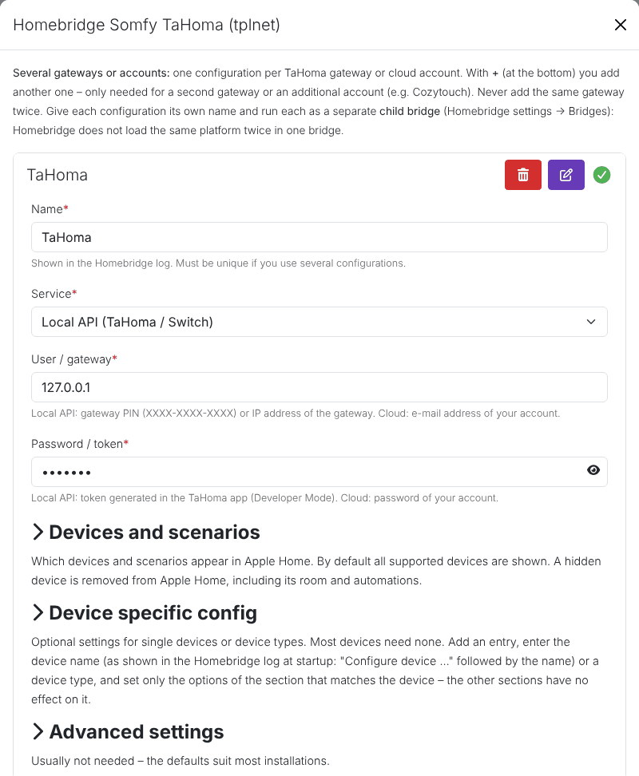
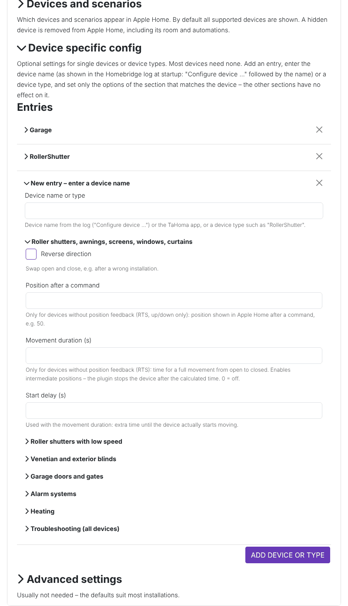

# Configuration

[← Back to the README](../README.md)

The settings form of the Homebridge UI covers everything described here. This page is the reference for all options and for editing `config.json` directly.

- [All options](#all-options)
- [Several gateways or accounts](#several-gateways-or-accounts)
- [Device specific configuration](#device-specific-configuration)

## All options

| Option | Type | Default | Description |
|---|---|---|---|
| `service` | string | `somfy_europe` | Service, see [Requirements](../README.md#requirements) |
| `user` | string | – | **Required.** Local: gateway PIN or IPv4 address. Cloud: account e-mail |
| `password` | string | – | **Required.** Local: API token. Cloud: account password |
| `pollingPeriod` | number (s) | `5` local / `60` cloud | Update interval: how often the plugin asks the gateway for changes made elsewhere (TaHoma app, remote, other systems). Cloud: at least 10, at most 60 |
| `refreshPeriod` | number (min) | `5` local / `1440` cloud | Full refresh interval, in case a change was missed. Local API: re-reads the states the gateway knows (cheap, no radio traffic). Cloud: asks the gateway to query the devices – allowed only once a day, lower values cause `429 QUOTA_EXCEEDED`. `0` disables it. Devices without feedback (RTS) cannot report their state either way |
| `tlsInsecure` | boolean | `false` | Local API only: skip the gateway certificate check (by default verified against the [Overkiz root CA](https://ca.overkiz.com/overkiz-root-ca-2048.crt)). Use only if the connection fails with a certificate error |
| `exclude` | string[] | `[]` | Devices and scenarios to hide: name as shown in the log at startup (e.g. `Garage` from the line `Configure device Garage`) or in the TaHoma app, a type from the line below it (UI class or widget, e.g. `"PositionableHorizontalAwning"`) or a radio protocol (`"io"`, `"rts"`). A hidden device is removed from Apple Home, including its room and automations |
| `exposeScenarios` | boolean / string[] | `false` | Cloud only (the local API offers no scenarios): show TaHoma scenarios as switches in Apple Home. `true` for all, or a list of scenario names for only these (JSON config) |
| `devicesConfig` | object[] | `[]` | Per-device settings, see [below](#device-specific-configuration) |
| `debug` | boolean | `false` | Detailed log for all devices (commands, states, requests to the gateway) – for troubleshooting. For a single device see [`devicesConfig`](#all-devices) |


## Several gateways or accounts

One configuration covers one gateway or cloud account. In the settings form, **+** at the bottom adds another configuration – only needed for a second gateway or an additional cloud account (e.g. Cozytouch next to Somfy).

- Never add the same gateway twice.
- Give each configuration its own `name`.
- Run each configuration as a separate **child bridge** (Homebridge settings → *Bridges*). Homebridge does not load the same platform twice in one bridge – it reports that the platform "is configured multiple times".

## Device specific configuration

Most devices work without any extra settings. `devicesConfig` (settings form: *Device specific config*) is only needed to adapt single devices or device types – for example a roller shutter installed the wrong way round, or an RTS shutter without position feedback.

<details>
<summary>Screenshots of the settings form</summary>

Top of the settings form – one configuration per gateway or account:



*Device specific config* with collapsed entries named after their device, and a new entry:



</details>

### Which name to enter (`key`)

Each entry applies to the devices matching its `key`:

- **A device name** – as shown in the Homebridge log at startup, or as named in the TaHoma app:
  ```
  [TaHoma] Configure device Garage
  [TaHoma]   GarageDoor > PositionableGarageDoor
  ```
  Here the name is `Garage`.
- **A device type** – the words in the line below the name: the first one (UI class, e.g. `RollerShutter`, `Awning`, `GarageDoor`) applies to all devices of this kind, the second one (widget, e.g. `PositionableGarageDoor`) to all devices of this model.

When several entries match a device, their settings are combined; the more specific one wins (device name over widget over UI class).

```json
"devicesConfig": [
    { "key": "Bedroom blind", "blindMode": true },
    { "key": "UpDownRollerShutter", "defaultPosition": 50 },
    { "key": "Garage", "debug": true },
    { "key": "Alarm", "stayZones": "A,C" }
]
```

Only the settings of the section that matches the device have an effect; the others are ignored for it. In the settings form, the sections are named after the device kinds.

### Roller shutters, awnings, screens, windows, curtains (WindowCovering)

| Setting | Type | Default | Description |
|---|---|---|---|
| `reverse` | boolean | `false` | Swap open and close (e.g. after a wrong installation) |
| `defaultPosition` | number | `0` | Only for devices without position feedback (RTS, up/down only): position shown after a command, e.g. `50` |
| `movementDuration` | number (s) | `0` | Only for devices without position feedback (RTS): time of a full movement from open to closed. Enables intermediate positions – the plugin stops the device after the calculated time (`0` = off) |
| `offsetMovementDuration` | number (s) | `0` | Used with `movementDuration`: extra time until the device actually starts moving |
| `lowSpeed` | boolean / string | `false` | Only for roller shutters with low speed (widget `PositionableRollerShutterWithLowSpeedManagement`): use the silent low speed. As string `"HH:MM-HH:MM"` only in that time slot (may span midnight, e.g. `"22:00-07:00"`; JSON config only) |

### Venetian and exterior blinds

| Setting | Type | Default | Description |
|---|---|---|---|
| `blindMode` | boolean | `false` | The main slider controls the slats: 100 % fully opens, 0 % fully closes, 1–99 % closes the blind and tilts the slats (99 % = horizontal, most light; 1 % = nearly closed) |
| `blindsOnRollerShutter` | boolean | `false` | Blinds driven by a roller shutter motor: at intermediate positions the blind moves a little further back so the slats stay open |

### Garage doors and gates (GarageDoorOpener)

| Setting | Type | Default | Description |
|---|---|---|---|
| `cyclic` | boolean | `false` | For doors without state feedback that close by themselves: show *closed* again after `cycleDuration` |
| `cycleDuration` | number (s) | `5` | Time until a cyclic door is shown as closed again |
| `pedestrianDuration` | number (s) | `0` | Gates without a pedestrian command (RTS): open for this time, then stop. Shown as an extra lock in Apple Home |

### Alarm systems

| Setting | Type | Default | Description |
|---|---|---|---|
| `stayZones` | string | `A` | Zones (A, B, C) armed in Apple Home's *Home* mode, e.g. `"A,C"` |
| `nightZones` | string | `B` | Zones (A, B, C) armed in Apple Home's *Night* mode |

### Heating

| Setting | Type | Default | Description |
|---|---|---|---|
| `derogationDuration` | number (h) | `1` | Atlantic / Thermor heating zones: duration of temporary temperature changes |
| `comfort` | number (°C) | `19` | Electrical heaters with pilot wire: temperature that stands for the comfort mode |
| `eco` | number (°C) | `17` | Electrical heaters with pilot wire: temperature that stands for the eco mode |

### All devices

| Setting | Type | Default | Description |
|---|---|---|---|
| `debug` | boolean | `false` | Troubleshooting: logs at startup which commands and states the gateway offers for this device, and more details about its commands (without changing the global `debug`) |
